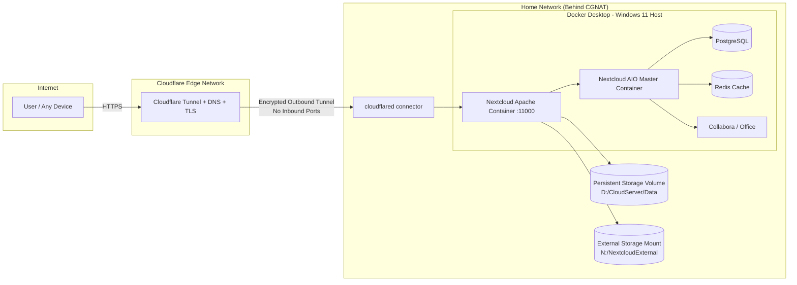

# ☁️ Nextcloud Homelab — Self-Hosted Private Cloud with Docker & Cloudflare Tunnel


> A fully documented, end-to-end engineering journey: turning a home PC into a secure, internet-accessible private cloud — without port forwarding, without a static IP, and without trusting a third-party storage provider with personal data.

---

## 📖 Overview

This repository documents the complete design, deployment, and operation of a **self-hosted Nextcloud instance**, running on **Docker Desktop (Windows 10)**, exposed securely to the internet through a **Cloudflare Tunnel**, and managed entirely through **Nextcloud All-in-One (AIO)**.

It was built to solve a real, personal problem — needing reliable, private, cross-device file storage — while working around a real, common infrastructure obstacle: an ISP-assigned **CGNAT (Carrier-Grade NAT)** connection that makes traditional port forwarding impossible.

This is not a copy-paste tutorial. Every document in this repository explains:

- **What** was done
- **Why** it was done that way
- **What alternatives existed**, and why they were rejected
- **What broke**, and how it was fixed
- **What would be done differently** next time

The result is both a working homelab and a written record of the decision-making behind it — intended to demonstrate real DevOps, systems administration, and networking competency to recruiters, collaborators, and future-me.

---

## 🎯 Project Goals

| Goal | Outcome |
|---|---|
| Build a private, self-hosted alternative to Google Drive / iCloud | ✅ Achieved with Nextcloud AIO |
| Avoid recurring cloud storage subscription costs | ✅ One-time hardware, no monthly storage fees |
| Expose the service securely over HTTPS | ✅ Cloudflare Tunnel + managed TLS |
| Solve remote access without port forwarding (CGNAT) | ✅ Outbound-only tunnel, no exposed ports |
| Learn production-grade container orchestration | ✅ Docker Compose, volumes, networking |
| Support multiple users with isolated storage & sharing | ✅ Nextcloud user/group management |
| Document the entire process to a portfolio standard | ✅ This repository |

---

## 🏗️ High-Level Architecture



> 📌 **Key architectural decision:** the tunnel connection is initiated **outbound** from inside the home network to Cloudflare. No inbound port is ever opened on the router, which is what makes this design work even under CGNAT. See [`04-CGNAT-Problem.md`](docs/04-CGNAT-Problem.md) and [`05-Cloudflare-Tunnel.md`](docs/05-Cloudflare-Tunnel.md) for the full reasoning.

---

## 🧰 Technology Stack

| Technology | Role | Why This Choice |
|---|---|---|
| **Windows 11** | Host operating system | Existing hardware already available; no need for a dedicated Linux box |
| **Docker Desktop** | Container runtime | Isolates services, reproducible deployments, easy rollback |
| **Nextcloud AIO** | Cloud application suite | Official, supported, bundles DB/cache/office/antivirus with sane defaults |
| **Cloudflare Tunnel** | Secure remote access | Solves CGNAT without VPN, without exposing ports, free tier available |
| **Cloudflare DNS** | Domain resolution | Free, integrates natively with Tunnel, supports proxied records |
| **Docker Volumes / Bind Mounts** | Persistent storage | Survives container recreation; data lives independently of the container lifecycle |
| **PowerShell** | Host administration & automation | Native to Windows; used for backups, updates, service management |
| **Git & GitHub** | Documentation & version control | Portfolio visibility, change history, collaboration |

---

## 📂 Repository Structure

```text
nextcloud-homelab/
│
├── README.md                     # You are here
├── LICENSE                       # MIT License
├── .gitignore                    # Excludes secrets, backups, local artifacts
│
├── docs/
│   ├── 01-Introduction.md            # Motivation, problem statement, project scope
│   ├── 02-Requirements.md            # Hardware, software, network prerequisites
│   ├── 03-Docker-Installation.md     # Installing & configuring Docker Desktop
│   ├── 04-CGNAT-Problem.md           # Why port forwarding wasn't an option
│   ├── 05-Cloudflare-Tunnel.md       # Secure remote access without open ports
│   ├── 06-Domain-and-DNS.md          # Domain registration & DNS configuration
│   ├── 07-Nextcloud-AIO.md           # Deploying Nextcloud All-in-One
│   ├── 08-Storage.md                 # Persistent storage & external storage design
│   ├── 09-Users-and-Sharing.md       # Multi-user setup, groups, permissions, sharing
│   ├── 10-External-Storage.md        # Mounting additional drives/network shares
│   ├── 11-Troubleshooting.md         # Real issues encountered and their fixes
│   ├── 12-Lessons-Learned.md         # Retrospective & what I'd do differently
│   └── Commands.md                   # Full command reference (Docker + PowerShell)
│
├── images/                       # Screenshots referenced by the docs
├── diagrams/                     # Exported architecture/network diagrams
└── videos/                       # Screen recordings / demo walkthroughs
```

---

## 🚀 Quick Start

> ⚠️ **Note:** This repository is documentation-first. It captures a real deployment rather than shipping a one-click installer, because the value of this project is in the *decision-making*, not just the end state. Follow the docs in numeric order for the full context.

```powershell
# 1. Clone this repository
git clone https://github.com/<your-username>/nextcloud-homelab.git
cd nextcloud-homelab

# 2. Read the docs in order, starting with the introduction
code docs/01-Introduction.md
```

For the actual deployment steps, start at [`docs/03-Docker-Installation.md`](docs/03-Docker-Installation.md).

---

## ✨ Features Delivered

- 🔒 Secure HTTPS access via Cloudflare-managed TLS certificates
- 🌍 Remote access from any device, anywhere — no VPN client required
- 🚫 Zero open inbound ports on the home router
- 👥 Multi-user support with per-user quotas and group-based sharing
- 🔗 Public and password-protected share links with expiry dates
- 💾 Persistent storage decoupled from container lifecycle
- 📦 External storage mounts for archival data
- 🔁 Backup and update automation via PowerShell scripts
- 🩺 Documented troubleshooting for every major failure encountered

---

## 📚 Documentation Index

| # | Document | Description |
|---|---|---|
| 01 | [Introduction](docs/01-Introduction.md) | Problem statement, goals, and scope |
| 02 | [Requirements](docs/02-Requirements.md) | Hardware, software, and network prerequisites |
| 03 | [Docker Installation](docs/03-Docker-Installation.md) | Installing and configuring Docker Desktop |
| 04 | [The CGNAT Problem](docs/04-CGNAT-Problem.md) | Why port forwarding wasn't viable |
| 05 | [Cloudflare Tunnel](docs/05-Cloudflare-Tunnel.md) | Secure outbound-only remote access |
| 06 | [Domain & DNS](docs/06-Domain-and-DNS.md) | Domain purchase and DNS configuration |
| 07 | [Nextcloud AIO](docs/07-Nextcloud-AIO.md) | Deploying the Nextcloud All-in-One stack |
| 08 | [Storage](docs/08-Storage.md) | Persistent storage architecture |
| 09 | [Users & Sharing](docs/09-Users-and-Sharing.md) | User/group management and sharing controls |
| 10 | [External Storage](docs/10-External-Storage.md) | Mounting additional drives and network shares |
| 11 | [Troubleshooting](docs/11-Troubleshooting.md) | Real problems and their resolutions |
| 12 | [Lessons Learned](docs/12-Lessons-Learned.md) | Retrospective and future improvements |
| — | [Commands Reference](docs/Commands.md) | Every Docker and PowerShell command used |

---

## 🖼️ Screenshots & Diagrams

Screenshots are stored in [`images/`](images/) and referenced inline throughout the docs.
Architecture and network diagrams are stored in [`images/`](diagrams/) as both Mermaid source and exported PNG/SVG.
Demo walkthroughs are stored in [`videos/`](videos/).

> 📸 *Screenshot placeholder — see individual docs for embedded, in-context screenshots (e.g. ``).*

---

## 🗺️ Future Roadmap

| Planned Addition | Purpose |
|---|---|
| Prometheus + Grafana | Monitoring & alerting for container health and resource usage |
| Vaultwarden | Self-hosted password manager alongside Nextcloud |
| WireGuard | Secondary private VPN access path as a redundancy to the tunnel |
| Automated offsite backups | 3-2-1 backup strategy with encrypted offsite copy |
| Migration to a dedicated Linux host | Remove dependency on Windows/Docker Desktop overhead |

---

## 🤝 Contributing

This is primarily a personal documentation project, but corrections, clarifications, and suggestions are welcome via Issues or Pull Requests.

## 📄 License

This project is licensed under the [MIT License](LICENSE).

## 👤 Author

**Muthuraman**
• Docker • Cloud Infrastructure • Networking • Self-Hosting

If this repository helped you, consider ⭐ starring it.
