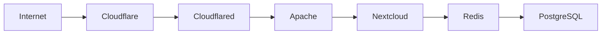

# Docker Network

## Overview

Docker creates an isolated virtual network allowing containers to communicate securely.

The Nextcloud AIO deployment automatically creates and manages this network.

---

## Architecture

---

## Components

### Apache

Receives HTTPS requests forwarded by Cloudflare Tunnel.

---

### Nextcloud

Main application.

Handles:

- Files
- Users
- Sharing
- Authentication

---

### PostgreSQL

Stores

- User accounts
- Shares
- Settings
- Metadata

---

### Redis

Provides

- Session caching
- File locking
- Performance improvements

---

### Collabora

Online document editing.

---

## Communication

Containers communicate over an internal Docker bridge network.

No internal services are directly exposed to the Internet.

---

## Ports

| Port | Purpose |
|-------|---------|
| 8080 | AIO Interface |
| 11000 | Apache |
| 443 | Domain validation (temporary) |

---

## Security

Advantages

- Container isolation
- Internal networking
- Reduced attack surface
- Easy scalability