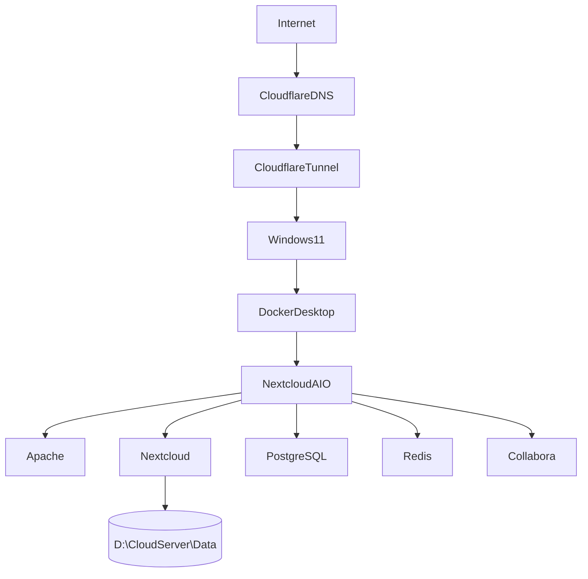

# Project Overview

## Introduction

This project documents the complete deployment of a self-hosted cloud platform using **Nextcloud All-in-One (AIO)** on **Docker Desktop** running on Windows 11.

The objective was to create a secure, remotely accessible, and maintainable cloud storage solution while gaining practical experience with Docker, networking, cloud security, DNS, and system administration.

Unlike a simple installation guide, this repository documents the engineering decisions, challenges, troubleshooting process, and lessons learned throughout the deployment.

---

# Project Objectives

The primary goals of this project were:

- Learn Docker fundamentals.
- Deploy a production-ready Nextcloud instance.
- Provide secure remote access.
- Avoid exposing ports directly to the Internet.
- Work around ISP CGNAT limitations.
- Learn Cloudflare Tunnel.
- Configure a custom domain.
- Implement persistent storage.
- Support multiple users.
- Maintain professional documentation.

---

# Project Scope

The deployment includes:

- Docker Desktop
- Nextcloud AIO
- Cloudflare Tunnel
- Cloudflare DNS
- HTTPS Encryption
- Multi-user configuration
- Persistent storage
- External storage planning
- Backup strategy
- Administrative documentation

---

# High-Level Architecture

---

# Project Timeline

| Phase | Description |
|--------|-------------|
| 1 | Install Docker Desktop |
| 2 | Deploy Nextcloud AIO |
| 3 | Attempt Port Forwarding |
| 4 | Discover CGNAT |
| 5 | Evaluate Tailscale |
| 6 | Configure Cloudflare Tunnel |
| 7 | Configure DNS |
| 8 | Deploy Nextcloud |
| 9 | Configure Users |
| 10 | Configure Storage |
| 11 | Plan External Storage |
| 12 | Documentation |

---

# Technologies Used

| Technology | Purpose |
|------------|---------|
| Windows 11 | Host OS |
| Docker Desktop | Container Platform |
| Nextcloud AIO | Cloud Platform |
| Cloudflare Tunnel | Secure Access |
| Cloudflare DNS | Domain Resolution |
| PowerShell | Administration |
| GitHub | Documentation |

---

# Expected Outcome

At the end of the project:

- Secure HTTPS cloud storage
- Remote accessibility
- Multi-user support
- Persistent storage
- Documented deployment process
- Portfolio-ready GitHub repository