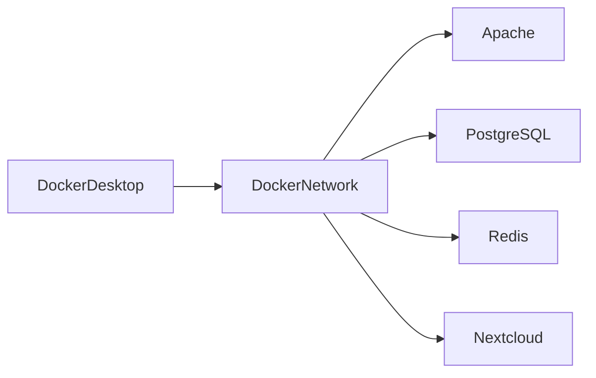

# Docker Setup

## Why Docker?

Docker packages applications into isolated containers.

Benefits:

- Easy deployment
- Portability
- Isolation
- Easy updates
- Simplified backups

---

# Docker Concepts Used

- Images
- Containers
- Volumes
- Networks
- Environment Variables

---

# Nextcloud Master Container

Deployment command:

```powershell
docker run -d `
--init `
--sig-proxy=false `
--name nextcloud-aio-mastercontainer `
--restart always `
-p 8080:8080 `
-v nextcloud_aio_mastercontainer:/mnt/docker-aio-config `
-v /run/host-services/docker.proxy.sock:/var/run/docker.sock:ro `
nextcloud/all-in-one:latest
```

---

# Verify Running Containers

```powershell
docker ps
```

---

# View Logs

```powershell
docker logs nextcloud-aio-mastercontainer
```

---

# Restart Container

```powershell
docker restart nextcloud-aio-mastercontainer
```

---

# Stop Container

```powershell
docker stop nextcloud-aio-mastercontainer
```

---

# Remove Container

```powershell
docker rm nextcloud-aio-mastercontainer
```

---

# Docker Volumes

Persistent storage is handled using Docker volumes.

View volumes:

```powershell
docker volume ls
```

---

# Docker Networking



---

# Environment Variables Used

| Variable | Purpose |
|----------|---------|
| APACHE_PORT | Reverse proxy port |
| APACHE_IP_BINDING | Apache binding |
| NEXTCLOUD_DATADIR | Data directory |
| NEXTCLOUD_MOUNT | External storage |

---

# Best Practices

- Never delete volumes unless intentionally resetting the installation.
- Restart containers after changing configuration.
- Monitor logs before troubleshooting.
- Keep Docker Desktop updated.

---

# References

- Docker Documentation
- Nextcloud AIO Documentation