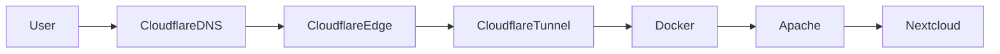

# Cloudflare Tunnel

## Overview

One of the biggest challenges when self-hosting applications from a home network is making them securely accessible from the Internet.

Initially, I planned to use traditional router port forwarding. However, my ISP placed my connection behind Carrier-Grade NAT (CGNAT), making inbound connections impossible.

To overcome this limitation, I deployed **Cloudflare Tunnel**, allowing secure HTTPS access without exposing my home network.

---

# Why Cloudflare Tunnel?

Cloudflare Tunnel creates an outbound encrypted connection from the local server to Cloudflare's edge network.

Advantages:

- No port forwarding required
- Works behind CGNAT
- Automatic HTTPS
- DDoS protection
- Zero Trust integration
- Secure outbound-only connection

---

# Architecture



---

# Tunnel Deployment

Docker command used:

```powershell
docker run -d `
--name cloudflared `
--restart unless-stopped `
cloudflare/cloudflared:latest `
tunnel --no-autoupdate run --token YOUR_TUNNEL_TOKEN
```

---

# Verify Tunnel

List containers:

```powershell
docker ps
```

View logs:

```powershell
docker logs cloudflared
```

Healthy tunnel example:

```
Registered tunnel connection
```

---

# Benefits

- No router configuration
- Secure HTTPS
- No exposed ports
- Easy deployment
- Automatic reconnection

---

# Lessons Learned

Cloudflare Tunnel proved to be a reliable alternative to traditional port forwarding, especially when working behind CGNAT.