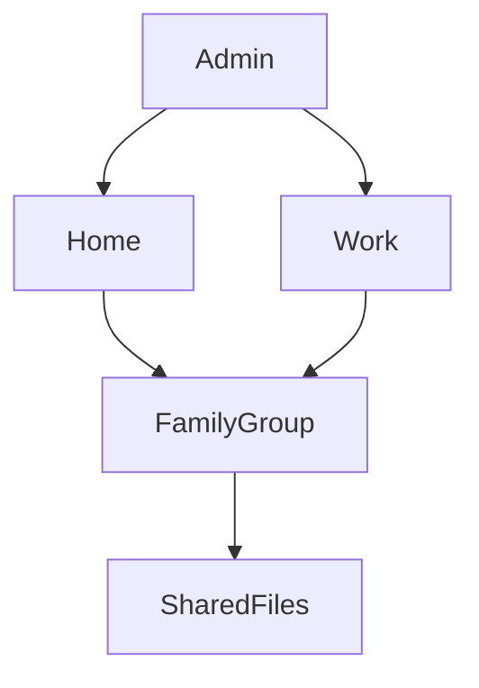

# User Management

## Overview

A cloud platform is only useful when users can securely access and collaborate on files. After deploying Nextcloud, I configured multiple users, groups, and sharing policies.

This document explains how user accounts were created and managed.

---

# User Architecture



---

# User Accounts

| Username | Role | Description |
|-----------|------|-------------|
| admin | Administrator | Server management and configuration |
| home | Standard User | Personal storage and files |
| work | Standard User | Work-related files |

---

# User Roles

## Administrator

Responsibilities:

- Configure server settings
- Manage applications
- Create users
- Configure sharing
- Monitor storage
- Update Nextcloud

The administrator account is **not** used for daily file storage.

---

## Standard Users

Standard users can:

- Upload files
- Download files
- Share files
- Synchronize devices
- Collaborate with other users

---

# User Groups

Created group:

```
family
```

Purpose:

- Simplify file sharing
- Manage permissions
- Prepare for future users

---

# Sharing Configuration

Enabled:

- Internal user sharing
- Group sharing
- Link sharing
- Password-protected public links

Disabled:

- Guessable share tokens

---

# Recommended Permissions

| Permission | Recommended |
|------------|-------------|
| Read | ✅ |
| Upload | ✅ |
| Edit | When required |
| Delete | When required |
| Reshare | Limited |

---

# Best Practices

- Keep administrator account separate.
- Create one account per person.
- Organize users into groups.
- Use strong passwords.
- Enable Two-Factor Authentication.

---

# Future Improvements

- LDAP integration
- Active Directory
- Group quotas
- User lifecycle management