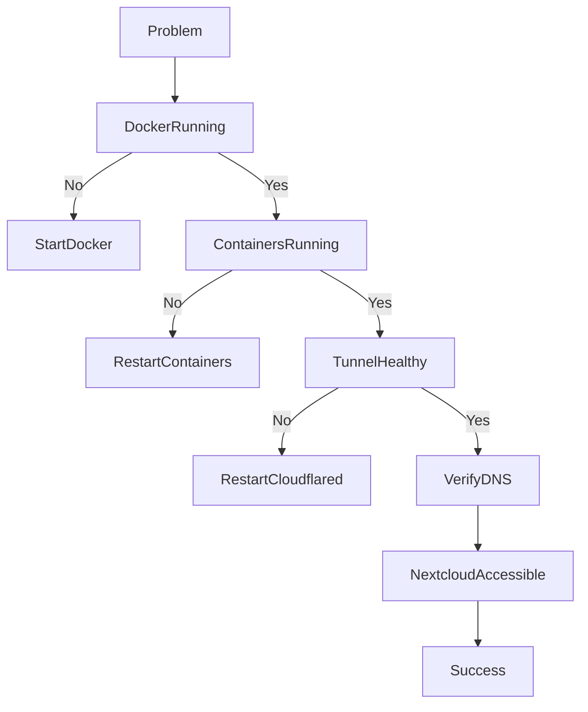

# Troubleshooting Guide

## Overview

During the deployment of my self-hosted Nextcloud instance, I encountered several technical challenges. This document records each issue, its root cause, and the solution implemented.

---

# Issue 1 — Docker Engine Not Running

## Symptoms

```
Failed to talk to server
```

## Cause

Docker Desktop was not running or the Docker Engine had not started.

## Solution

1. Open Docker Desktop.
2. Wait until the engine status shows **Running**.
3. Verify with:

```powershell
docker ps
```

---

# Issue 2 — Port Forwarding Failed

## Symptoms

Nextcloud was inaccessible from outside the local network.

## Cause

The ISP uses **Carrier-Grade NAT (CGNAT)**, preventing inbound connections.

## Solution

Replaced port forwarding with **Cloudflare Tunnel**, which establishes an outbound encrypted tunnel to Cloudflare.

---

# Issue 3 — Domain Validation Failed

## Symptoms

```
Domain does not point to this server.
```

## Cause

Incorrect reverse proxy configuration or tunnel service mapping.

## Solution

Verified:

- Cloudflare Tunnel status
- Public Hostname configuration
- Apache port (11000)
- DNS records

---

# Issue 4 — Cloudflare Tunnel Offline

## Symptoms

```
Tunnel Status: Down
```

## Cause

The `cloudflared` container had stopped or was removed.

## Solution

Recreated the connector:

```powershell
docker run -d `
--name cloudflared `
--restart unless-stopped `
cloudflare/cloudflared:latest `
tunnel --no-autoupdate run --token YOUR_TUNNEL_TOKEN
```

---

# Issue 5 — Docker Container Name Conflict

## Symptoms

```
Conflict. The container name is already in use.
```

## Cause

A container with the same name already existed.

## Solution

```powershell
docker stop nextcloud-aio-mastercontainer
docker rm nextcloud-aio-mastercontainer
```

Then recreate the container.

---

# Issue 6 — Changing NEXTCLOUD_DATADIR

## Symptoms

Nextcloud failed after changing the data directory.

## Cause

Changing `NEXTCLOUD_DATADIR` after initialization is unsupported.

## Solution

Performed a clean installation with the correct data directory configured before initialization.

---

# Issue 7 — External Storage Planning

## Requirement

Add removable storage without affecting the primary data directory.

## Solution

Configured:

```powershell
NEXTCLOUD_MOUNT=/run/desktop/mnt/host/n/NextcloudExternal
```

Enabled the **External Storage Support** app and mounted the removable drive as additional storage.

---

# Useful Diagnostic Commands

Check running containers:

```powershell
docker ps
```

Check all containers:

```powershell
docker ps -a
```

View logs:

```powershell
docker logs nextcloud-aio-mastercontainer
```

Restart a container:

```powershell
docker restart nextcloud-aio-mastercontainer
```

Inspect environment variables:

```powershell
docker inspect nextcloud-aio-mastercontainer --format "{{json .Config.Env}}"
```

---

# Troubleshooting Flow



---

# Key Takeaways

- Always inspect logs before making configuration changes.
- Keep backups before modifying storage settings.
- Verify networking step by step rather than changing multiple settings at once.