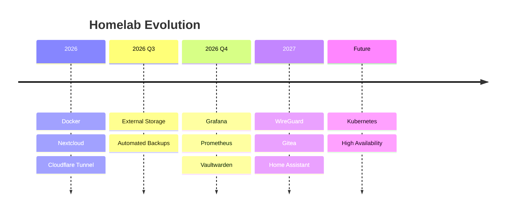

# Future Roadmap

## Overview

The current deployment provides a stable self-hosted cloud platform. Future enhancements will expand functionality, improve reliability, and strengthen security.

---

# Planned Projects

## External Storage

Status:

🟡 Planned

Objectives:

- USB HDD integration
- Hot-plug support
- Additional storage capacity

---

## Automated Backups

Status:

🟡 Planned

Features:

- Scheduled backups
- Backup verification
- External drive support

---

## Monitoring

Status:

🟡 Planned

Stack:

- Grafana
- Prometheus

Objectives:

- CPU monitoring
- Memory monitoring
- Storage monitoring
- Docker metrics

---

## Vaultwarden

Status:

🟡 Planned

Purpose:

Self-hosted password manager.

---

## WireGuard VPN

Status:

🟡 Planned

Purpose:

Secure remote administration.

---

## Home Assistant

Status:

🟡 Planned

Purpose:

Home automation integration.

---

## Gitea

Status:

🟡 Planned

Purpose:

Self-hosted Git repository.

---

## CI/CD

Status:

🟡 Planned

Using:

- GitHub Actions

Objectives:

- Documentation validation
- Automated testing
- Markdown linting

---

## Kubernetes

Status:

🔵 Long-Term Goal

Objectives:

- Learn orchestration
- Multi-container deployments
- High availability

---

# Roadmap

---

# Long-Term Vision

Create a complete self-hosted homelab featuring:

- Cloud Storage
- Monitoring
- Password Management
- VPN
- Source Control
- Automation
- Container Orchestration

The objective is to continuously learn modern infrastructure technologies while maintaining a practical environment for experimentation and development.